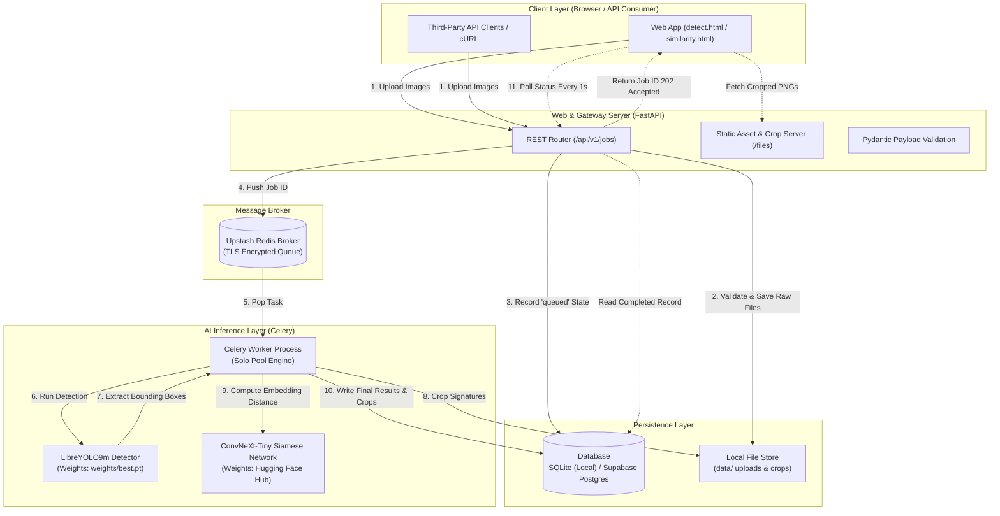
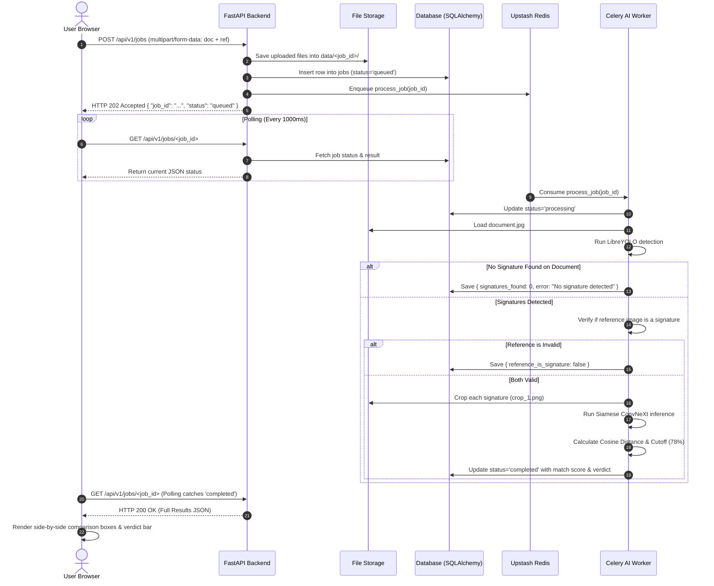
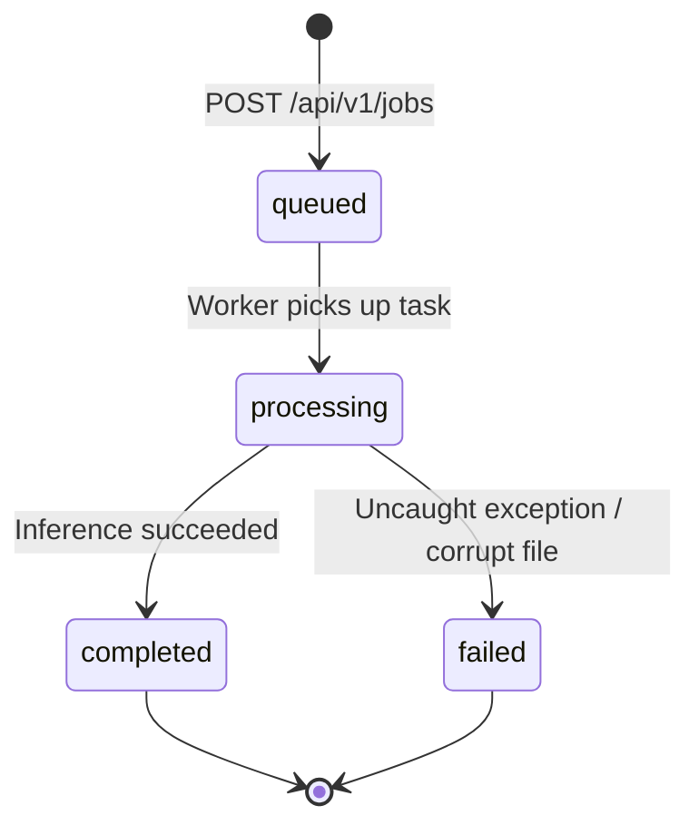

# 📖 SignIQ — Complete Codebase Architecture & Engineering Walkthrough

> **A comprehensive guide to the SignIQ platform: System Design, File-by-File Breakdown, Deep Learning Pipelines, and Architectural Decisions.**

---

## 📑 Table of Contents
1. [Executive Summary & Problem Statement](#1-executive-summary--problem-statement)
2. [High-Level System Architecture](#2-high-level-system-architecture)
3. [End-to-End Workflow & Data Flow](#3-end-to-end-workflow--data-flow)
4. [Complete File-by-File Guide](#4-complete-file-by-file-guide)
   - [Backend Core (`app/`)](#-backend-core-app)
   - [AI Workers & Inference (`worker/`)](#-ai-workers--inference-worker)
   - [Modern Neo-Brutalist Web UI (`frontend/`)](#-modern-neo-brutalist-web-ui-frontend)
   - [Configuration & Infrastructure](#-configuration--infrastructure)
5. [Key Engineering Decisions: Why Everything Was Added](#5-key-engineering-decisions-why-everything-was-added)
6. [Data Models & State Transitions](#6-data-models--state-transitions)
7. [Summary Table of All Components](#7-summary-table-of-all-components)

---

## 1. Executive Summary & Problem Statement

### What is SignIQ?
**SignIQ** is an autonomous, full-stack AI platform designed to solve two critical challenges in document security and workflow automation:
1. **Signature Localization**: Finding where signatures exist across complex, messy scanned documents (cheques, contracts, forms, letters) regardless of rotation, lighting, stamps, or background text.
2. **Signature Verification**: Verifying whether a detected signature actually belongs to the claimed individual by comparing it against a verified reference signature in high-dimensional feature space.

### The Real-World Problem
Traditional document processing requires manual inspection by human officers, which is slow, prone to cognitive fatigue, and easily fooled by traced or skilled forgeries. SignIQ replaces manual verification with a sub-second, two-stage deep learning pipeline wrapped in an intuitive, accessible web application.

---

## 2. High-Level System Architecture

SignIQ is built using an asynchronous micro-service design pattern. The compute-intensive AI operations are completely decoupled from the lightweight web server via a distributed task queue.

---

## 3. End-to-End Workflow & Data Flow

When a user drops a document and a reference signature into the web application, the system executes an automated sequence across both services:

---

## 4. Complete File-by-File Guide

### 📂 Backend Core (`app/`)

#### 1. [`app/main.py`](file:///d:/SignIQ/backend/backend/app/main.py)
* **What it is**: The main entry point for the HTTP web server.
* **Key Responsibilities**:
  - Initializes FastAPI with OpenAPI / Swagger documentation (`/docs`).
  - Sets up CORS (Cross-Origin Resource Sharing) middleware to allow frontend access.
  - Mounts `/files` to serve cropped signatures and uploaded documents securely.
  - Mounts `/` to serve the static frontend (`frontend/`).
  - Implements the primary REST endpoints:
    - `GET /health`: Instant health-check probe.
    - `POST /api/v1/jobs`: Accepts multipart uploads, saves them, generates a UUID `job_id`, records them in the database, and publishes a Celery task.
    - `GET /api/v1/jobs/{job_id}`: Allows client polling to check status (`queued` $\to$ `processing` $\to$ `completed` / `failed`).

#### 2. [`app/config.py`](file:///d:/SignIQ/backend/backend/app/config.py)
* **What it is**: Centralized configuration management using `python-dotenv`.
* **Key Responsibilities**:
  - Resolves file paths relative to project root (`BASE_DIR`, `DATA_DIR`).
  - Loads credentials (Upstash `REDIS_URL`, Supabase `DATABASE_URL`).
  - Configures model hyper-parameters:
    - `DETECT_CONF = 0.385`: Detection confidence threshold.
    - `DETECT_IOU = 0.5`: Intersection-over-Union threshold for Non-Maximum Suppression (NMS).
  - Enforces upload file limits (10 MB max, allowed formats: PNG, JPG, WebP).

#### 3. [`app/db.py`](file:///d:/SignIQ/backend/backend/app/db.py)
* **What it is**: Database abstraction using SQLAlchemy 2.0 ORM.
* **Key Responsibilities**:
  - Defines the `Job` database table schema:
    - `id` (String primary key): UUID identifying the job.
    - `status` (String): Tracks progress (`queued`, `processing`, `completed`, `failed`).
    - `document_key` / `reference_key` (String): Storage paths.
    - `result` (JSON): Stores detection coordinates, confidence, similarity score, and verdict.
    - `error` (Text): Failure stack trace or error reason.
    - `created_at` / `updated_at` (DateTime with timezone).
  - Provides thread-safe session factories (`SessionLocal`) and the `get_db()` dependency injector.

#### 4. [`app/celery_app.py`](file:///d:/SignIQ/backend/backend/app/celery_app.py)
* **What it is**: Celery task runner initialization.
* **Key Responsibilities**:
  - Connects to Upstash Redis using TLS (`rediss://`).
  - Configures task serialization (JSON) and registers worker tasks under the `tasks` namespace.

#### 5. [`app/storage.py`](file:///d:/SignIQ/backend/backend/app/storage.py)
* **What it is**: Storage driver abstraction.
* **Key Responsibilities**:
  - Handles writing uploaded files to disk under clean, isolated job folders (`data/<job_id>/document.jpg`).
  - Converts disk file keys into accessible HTTP URLs (`/files/<job_id>/crop_1.png`).

#### 6. [`app/schemas.py`](file:///d:/SignIQ/backend/backend/app/schemas.py)
* **What it is**: Pydantic models for strict JSON request/response validation.
* **Key Responsibilities**:
  - `JobCreateResponse`: Schema returned when a job is enqueued (`job_id`, `status`).
  - `JobResponse`: Comprehensive schema returned upon completion including bounding boxes, similarity scores, and execution timestamps.

---

### 🧠 AI Workers & Inference (`worker/`)

#### 7. [`worker/models.py`](file:///d:/SignIQ/backend/backend/worker/models.py)
* **What it is**: Model loader and memory manager.
* **Key Responsibilities**:
  - Implements the **Singleton pattern** for model instances (`_detector`, `_sim_model`, `_sim_inference`).
  - `preload_models()`: Connects to Celery's `@worker_ready.connect` signal. When the worker boots, it pre-loads both multi-gigabyte models into RAM/VRAM so the user's first job suffers zero cold-start delay.
  - Supports loading weights from local paths (`weights/best.pt`) with automatic Hugging Face Hub fallback (`snapshot_download`).

#### 8. [`worker/pipeline.py`](file:///d:/SignIQ/backend/backend/worker/pipeline.py)
* **What it is**: Pure computer-vision and model-evaluation functions (no Celery/HTTP dependencies).
* **Key Responsibilities**:
  - `detect(detector, image_path, conf, iou)`: Runs LibreYOLO prediction. Handles Windows-specific tensor list/single-object unpacking and returns standardized bounding box dictionaries `[x1, y1, x2, y2]`.
  - `crop_and_save(image, box, out_path)`: Uses Pillow to crop the detected signature bounding box with integer clamping, saving it as an isolated PNG.
  - `compare(sim_model, inference_module, crop_path, ref_path)`: Feeds both crops into the Siamese network, computes feature distance, and applies the definitive $\ge 77.85\%$ classification threshold to return **`SIMILAR`** or **`NOT_SIMILAR`**.

#### 9. [`worker/tasks.py`](file:///d:/SignIQ/backend/backend/worker/tasks.py)
* **What it is**: Celery background task orchestrator (`tasks.process_job`).
* **Key Responsibilities**:
  - Updates job state in SQLite/Postgres to `processing`.
  - **Document Signature Check**: Checks if any signatures are detected on the document. If 0 are found, safely halts and flags that the document has no signature.
  - **Reference Signature Validation**: Checks if the uploaded reference image actually contains signature strokes before attempting comparison.
  - Iterates over detected document signatures, generates crops, calls the comparison pipeline, and commits the final structured JSON results.

---

### 🎨 Modern Neo-Brutalist Web UI (`frontend/`)

#### 10. [`frontend/index.html`](file:///d:/SignIQ/backend/backend/frontend/index.html)
* **What it is**: The main landing page.
* **Features**:
  - Expressive Neo-Brutalist design (Bricolage Grotesque typography, high-contrast borders, pastel backgrounds).
  - Feature overview, interactive product flow explanation, and direct navigation links to Detection and Similarity modes.

#### 11. [`frontend/detect.html`](file:///d:/SignIQ/backend/backend/frontend/detect.html)
* **What it is**: Document Signature Detection tool interface.
* **Features**:
  - Drag-and-drop file upload zone with instant image preview.
  - Full-width results toolbar with "Scan Next Document ↺" reset button.
  - Side-by-side two-column layout:
    - **Left**: Document Overview panel rendering an HTML5 Canvas bounding all located signatures in real-time.
    - **Right**: Summary card (`✔ 1 Signature Located`) and detection cards showing cropped signatures and animated confidence bars.

#### 12. [`frontend/similarity.html`](file:///d:/SignIQ/backend/backend/frontend/similarity.html)
* **What it is**: Signature Similarity Verification tool interface.
* **Features**:
  - Dual upload zones (Document Image + Reference Signature).
  - Clean focused verification view without visual clutter.
  - Renders the **Dual Side-by-Side Comparison Box** (`📄 Document Signature` vs `🖋 Reference Signature`).
  - Displays the prominent match percentage, animated progress bar, and unambiguous **`✔ SIMILAR`** or **`✖ NOT SIMILAR`** verdict banner.

#### 13. [`frontend/js/tool.js`](file:///d:/SignIQ/backend/backend/frontend/js/tool.js)
* **What it is**: The dynamic controller for both interactive tool pages.
* **Key Responsibilities**:
  - Drag-and-drop state management and local preview generation using `URL.createObjectURL`.
  - Form submission and status state toggling (displays animated spinner during scanning).
  - Polling coordinator: calls `runJob()` from `api.js` and updates the UI based on job stages.
  - Dynamic canvas rendering: calculates coordinate aspect ratios, draws high-visibility teal/green bounding boxes, and prints label tags.
  - Card generator: builds dual-box comparison templates with animated CSS progress bars.

#### 14. [`frontend/js/api.js`](file:///d:/SignIQ/backend/backend/frontend/js/api.js)
* **What it is**: REST API client library.
* **Key Responsibilities**:
  - Dispatches `POST /api/v1/jobs` with `FormData`.
  - Implements recursive `poll()` with 1000ms delay until status reaches `completed` or `failed`.

#### 15. [`frontend/css/style.css`](file:///d:/SignIQ/backend/backend/frontend/css/style.css)
* **What it is**: Custom stylesheet implementing the complete Neo-Brutalist design system.
* **Design System Properties**:
  - Solid, intentional black borders (`2px solid var(--ink)`).
  - Flat, crisp drop shadows (`4px 4px 0 var(--ink)`).
  - Expressive typography: `Bricolage Grotesque` (bold headings), `JetBrains Mono` (metrics & tags), `Instrument Serif` (editorial accents).
  - Semantic color palette: Cream (`#fffdf7`), Lavender (`#e3ddff`), Teal (`#1f7a6d`), Red (`#d63031`), Orange (`#ff5722`).

---

### ⚙️ Configuration & Infrastructure

#### 16. [`.gitignore`](file:///d:/SignIQ/backend/backend/.gitignore)
* **What it does**: Ensures rock-solid security and keeps the git repository clean:
  - Excludes `.env` and all secret files (Upstash passwords, Supabase keys).
  - Excludes the `data/` directory (prevents user uploads from leaking into git).
  - Excludes the 240 MB `weights/best.pt` file (prevents breaking GitHub's 100MB file limit).
  - Excludes Python `.venv/` and `__pycache__/`.

#### 17. [`.env.example`](file:///d:/SignIQ/backend/backend/.env.example)
* **What it does**: Public configuration template for developers cloning the project. Contains placeholder variables with clear explanatory comments.

#### 18. [`requirements.txt`](file:///d:/SignIQ/backend/backend/requirements.txt)
* **What it does**: Pinned Python package dependencies ensuring identical reproducible builds across environments (`fastapi`, `uvicorn`, `celery`, `redis`, `torch`, `torchvision`, `libreyolo`, `huggingface_hub`, `pillow`, `sqlalchemy`).

---

## 5. Key Engineering Decisions: Why Everything Was Added

| Decision / Feature | Problem It Solved | How It Was Solved |
| :--- | :--- | :--- |
| **Asynchronous Task Queue (Celery + Redis)** | Deep learning models take 1–3 seconds to run. Running them synchronously in FastAPI would block HTTP workers and cause connection timeouts under traffic. | FastAPI receives the file, creates a job record, pushes it to an Upstash Redis queue, and immediately returns a `job_id`. The client polls asynchronously. |
| **Worker Model Preloading** | Loading multi-gigabyte PyTorch models on each request takes 5-10 seconds of cold-start latency. | Used `@worker_ready.connect` signal in `models.py` to load LibreYOLO and ConvNeXt into memory when the worker process boots. Subsequent requests execute instantly. |
| **Pre-Match Signature Check** | If a user uploaded an image without a signature (e.g. an ID card photo or a blank document), the Siamese network would still output an arbitrary comparison number. | Added validation in `worker/tasks.py`: the detector verifies signatures on the document, and pre-checks the reference image before running the similarity model. |
| **Strict Binary Verdicts (`SIMILAR` vs `NOT SIMILAR`)** | Intermediate classifications like "SUSPICIOUS" or "INCONCLUSIVE" confuse end users and don't provide actionable answers. | Simplified logic to strictly 2 outcomes: If score $\ge 77.85\% \to$ **`SIMILAR`**, otherwise $\to$ **`NOT SIMILAR`**, while always displaying the exact match percentage bar. |
| **Dual Comparison UI** | Users couldn't tell which signature from the document was being compared against the reference. | Replaced confusing overview cards with side-by-side dual boxes (`📄 Document Signature` vs `🖋 Reference Signature`) with the verdict displayed directly below. |
| **Zero-Framework Neo-Brutalism** | Modern JS frameworks (React/Vue/Webpack) add thousands of dependencies and complex build chains. | Used native HTML5/CSS3/ES6 served directly by FastAPI. Zero build steps, instant load times, and responsive across desktop and mobile. |

---

## 6. Data Models & State Transitions

### Job Lifecycle State Machine

### Database Schema Table (`jobs`)

| Column Name | SQL Type | Constraints | Description |
| :--- | :--- | :--- | :--- |
| `id` | `VARCHAR(36)` | `PRIMARY KEY` | Unique UUIDv4 identifier for the job |
| `status` | `VARCHAR(20)` | `NOT NULL`, Default: `'queued'` | Lifecycle stage: `queued`, `processing`, `completed`, `failed` |
| `document_key` | `VARCHAR(300)` | `NOT NULL` | Path where the uploaded document image is stored |
| `reference_key` | `VARCHAR(300)` | `NULLABLE` | Path to the target reference signature (if similarity mode) |
| `result` | `JSON` / `JSONB` | `NULLABLE` | Full model payload (detections, boxes, similarity scores, verdicts) |
| `error` | `TEXT` | `NULLABLE` | Error message if status transitioned to `failed` |
| `created_at` | `TIMESTAMPTZ` | `NOT NULL` | Timestamp when the job was submitted |
| `updated_at` | `TIMESTAMPTZ` | `NOT NULL` | Timestamp when the job was last updated |

---

## 7. Summary Table of All Components

| Path | Primary Language | Role in System |
| :--- | :--- | :--- |
| [`app/main.py`](file:///d:/SignIQ/backend/backend/app/main.py) | Python (FastAPI) | HTTP Gateway, routing, CORS, and static file serving |
| [`app/config.py`](file:///d:/SignIQ/backend/backend/app/config.py) | Python | Configuration, model parameters, and environment management |
| [`app/db.py`](file:///d:/SignIQ/backend/backend/app/db.py) | Python (SQLAlchemy) | Database connection and `Job` table ORM mapping |
| [`app/celery_app.py`](file:///d:/SignIQ/backend/backend/app/celery_app.py) | Python (Celery) | Task queue broker setup with Upstash Redis |
| [`app/schemas.py`](file:///d:/SignIQ/backend/backend/app/schemas.py) | Python (Pydantic) | Request/Response JSON serialization & validation schemas |
| [`app/storage.py`](file:///d:/SignIQ/backend/backend/app/storage.py) | Python | Disk write operations and public URL mapping for crops |
| [`worker/models.py`](file:///d:/SignIQ/backend/backend/worker/models.py) | Python (PyTorch/HF) | Singleton AI model initialization and memory pre-loading |
| [`worker/pipeline.py`](file:///d:/SignIQ/backend/backend/worker/pipeline.py) | Python (OpenCV/PIL) | YOLO coordinate extraction, crop generation, and Siamese distance calculation |
| [`worker/tasks.py`](file:///d:/SignIQ/backend/backend/worker/tasks.py) | Python (Celery) | Background job runner, pre-match validator, and database updater |
| [`frontend/detect.html`](file:///d:/SignIQ/backend/backend/frontend/detect.html) | HTML5 | UI for full document signature detection with interactive canvas |
| [`frontend/similarity.html`](file:///d:/SignIQ/backend/backend/frontend/similarity.html) | HTML5 | UI for 1-to-1 signature comparison with side-by-side view |
| [`frontend/css/style.css`](file:///d:/SignIQ/backend/backend/frontend/css/style.css) | CSS3 | Complete Neo-Brutalist design system, responsive grids, and animations |
| [`frontend/js/tool.js`](file:///d:/SignIQ/backend/backend/frontend/js/tool.js) | JavaScript (ES6) | Frontend event handling, canvas drawing, and dynamic DOM rendering |
| [`frontend/js/api.js`](file:///d:/SignIQ/backend/backend/frontend/js/api.js) | JavaScript (ES6) | HTTP client handling multipart form uploads and recursive polling |

---

  Document generated for <b>SignIQ</b> · Automated Signature Verification Architecture

