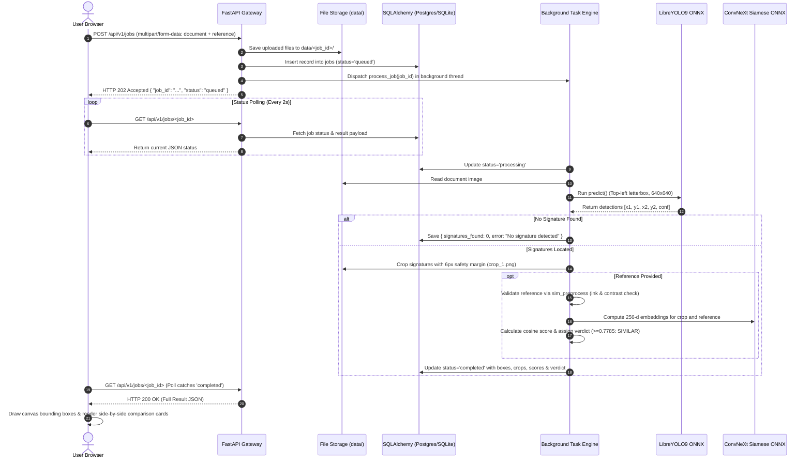
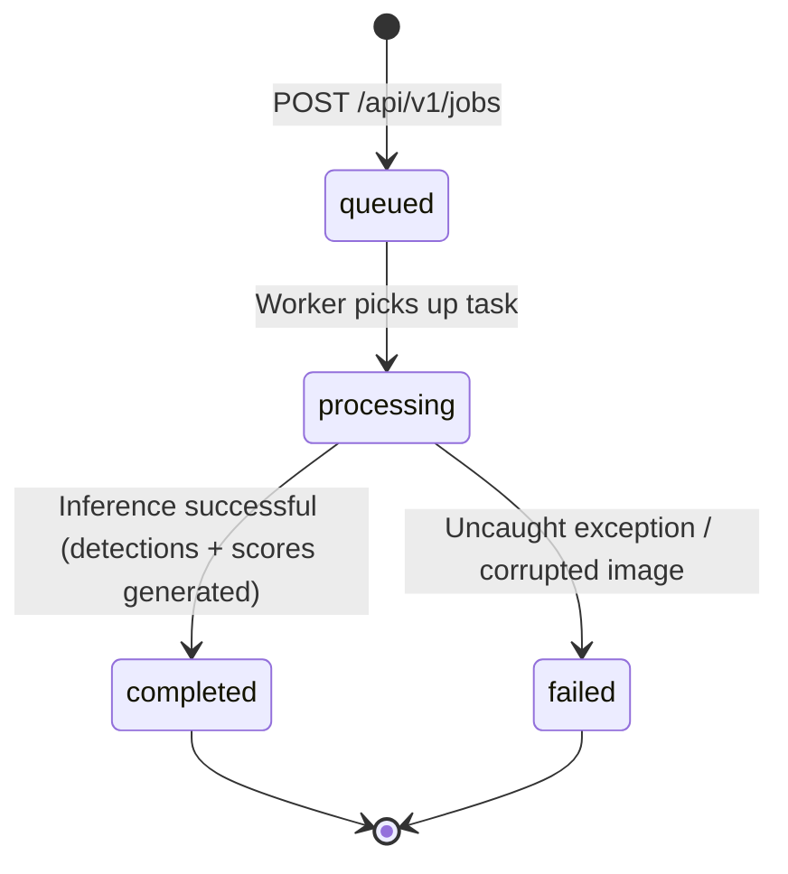

# 📖 SignIQ — Complete Codebase Architecture & Engineering Walkthrough

> **A comprehensive technical guide to the SignIQ platform: System Design, File-by-File Analysis, Pure-ONNX Deep Learning Pipelines, and Architectural Decisions.**

---

## 📑 Table of Contents
1. [Executive Summary & Problem Statement](#1-executive-summary--problem-statement)
2. [High-Level System Architecture & Design Approaches](#2-high-level-system-architecture--design-approaches)
3. [End-to-End Workflow & Data Flow](#3-end-to-end-workflow--data-flow)
4. [Complete File-by-File Engineering Guide](#4-complete-file-by-file-engineering-guide)
   - [Backend Gateway & API (`app/`)](#-backend-gateway--api-app)
   - [AI Workers & Pure-ONNX Runtime (`worker/`)](#-ai-workers--pure-onnx-runtime-worker)
   - [Modern Neo-Brutalist Web UI (`frontend/`)](#-modern-neo-brutalist-web-ui-frontend)
   - [Build & Model Optimization Scripts (`scripts/`)](#-build--model-optimization-scripts-scripts)
   - [Infrastructure & Configuration](#-infrastructure--configuration)
5. [Key System Design Approaches & Architectural Solutions](#5-key-system-design-approaches--architectural-solutions)
6. [Data Models & Lifecycle State Machine](#6-data-models--lifecycle-state-machine)
7. [Comprehensive Component Index](#7-comprehensive-component-index)

---

## 1. Executive Summary & Problem Statement

### What is SignIQ?
**SignIQ** is an autonomous, full-stack AI platform designed to automate document verification through a two-stage deep learning pipeline:
1. **Signature Localization (LibreYOLO9m)**: Automatically locates all handwritten signatures across scanned documents (contracts, bank cheques, legal petitions, tax forms) regardless of orientation, page folds, lighting variations, or overlapping printed text.
2. **Signature Verification (ConvNeXt-Tiny Siamese Network)**: Compares detected signature crops against a verified reference signature in high-dimensional feature space (256-d normalized embeddings) to detect traced, copied, or mismatched signatures.

### The Engineering Challenge
Deep learning models typically require dedicated GPUs and gigabytes of memory. Deploying such pipelines on cost-effective cloud services (such as **Render Free Tier: 512 MB RAM, 0.1 vCPU**) causes immediate Out-of-Memory (`SIGKILL 137`) crashes and CPU timeouts. 

SignIQ overcomes this through a **pure-ONNX runtime architecture** where PyTorch is completely eliminated from the production server, memory usage drops from ~1 GB to ~220 MB, and execution times drop by 3x–10x.

---

## 2. High-Level System Architecture & Design Approaches

SignIQ uses an asynchronous, decoupled service architecture that supports both single-instance free cloud tiers and multi-worker production clusters.

```mermaid
graph TB
    subgraph ClientLayer ["Client Layer (Browser / Mobile / API)"]
        UI["Modern Web App\n(detect.html / similarity.html)"]
        Camera["Webcam / Mobile Camera Module\n(js/camera.js)"]
        API_Client["Third-Party API Clients / cURL"]
    end

    subgraph WebServer ["Web & Gateway Layer (FastAPI / Uvicorn)"]
        Router["REST Router (/api/v1/jobs)"]
        FileServer["Static Asset & Crop Server (/files)"]
        StaticFrontend["Direct Frontend Static Mount (/)"]
        CORS["Universal Wildcard CORS Middleware"]
    end

    subgraph ExecutionLayer ["Dual-Mode Execution Engine"]
        AsyncTasks["In-Process Background Tasks\n(anyio Threadpool - Free Cloud Mode)"]
        CeleryWorker["Distributed Celery Worker\n(Redis Queue - Cluster Mode)"]
    end

    subgraph ModelLayer ["Pure-ONNX AI Runtime (Zero PyTorch)"]
        YOLO["OnnxDetector (best.onnx - 80 MB)\nLibreYOLO9m • Top-Left Letterbox"]
        Preprocess["sim_preprocess.py\nInk Isolation • Contrast Stretch"]
        Siamese["ConvNeXt-Tiny Siamese (similarity.onnx - 112 MB)\n256-d Embedding Cosine Distance"]
    end

    subgraph Persistence ["Persistence Layer"]
        DB[("Database Router\nSupabase Postgres (IPv4 Pooler:6543)\nFallback: Local SQLite (jobs.db)")]
        DiskStorage["Isolated Storage Engine\n(data/<job_id>/ crops & documents)"]
    end

    Camera --> UI
    UI -->|1. Submit Multipart Form| Router
    API_Client -->|1. Submit Multipart Form| Router
    Router -->|2. Store Raw Uploads| DiskStorage
    Router -->|3. Record 'queued' State| DB
    Router -.->|4. Return 202 Accepted + job_id| UI

    Router -->|Mode: Free Tier| AsyncTasks
    Router -->|Mode: Scaled Cluster| CeleryWorker

    AsyncTasks -->|5. Run Detection| YOLO
    CeleryWorker -->|5. Run Detection| YOLO
    YOLO -->|6. Bounding Boxes| DiskStorage
    AsyncTasks -->|7. Verify Reference| Preprocess
    AsyncTasks -->|8. Cosine Similarity| Siamese
    Siamese -->|9. Commit Results & Verdict| DB

    UI -.->|10. Poll Status (/api/v1/jobs/id)| Router
    Router -.->|Read Status| DB
    UI -.->|11. Fetch Cropped Signatures| FileServer
```

---

## 3. End-to-End Workflow & Data Flow

When a user uploads a document and an optional reference signature, the system executes an automated workflow:



---

## 4. Complete File-by-File Engineering Guide

### 📂 Backend Gateway & API (`app/`)

#### 1. [`app/main.py`](file:///d:/SignIQ/backend/backend/app/main.py)
* **Role**: Primary HTTP application gateway and routing hub.
* **Core Mechanisms**:
  - Initializes FastAPI with OpenAPI documentation (`/docs`, `/redoc`).
  - **Universal Wildcard CORS**: Configures `CORSMiddleware` with `allow_origins=["*"]` to ensure browsers on Vercel, localhost, or custom domains can access the API without preflight rejections.
  - **Static Asset Serving**: Mounts `/files` to serve cropped signature PNGs and documents from `DATA_DIR`. Mounts `/` to serve the static frontend directory, providing a full-stack experience from a single service.
  - **Dual-Mode Dispatching**: Inspects `USE_CELERY` environment variable. If `true`, dispatches tasks through Celery + Redis; if `false` (default for Render Free), dispatches tasks via FastAPI `BackgroundTasks`.
  - **REST Endpoints**:
    - `GET /health`: Health-check probe returning `{"status": "ok", "engine": "onnx"}`.
    - `POST /api/v1/jobs`: Receives document and optional reference files, validates format (PNG, JPG, WebP $\le$ 10 MB), writes to disk, commits `queued` state, and returns `202 Accepted`.
    - `GET /api/v1/jobs/{job_id}`: Poll endpoint returning job status, bounding boxes, crops, and similarity results.

#### 2. [`app/config.py`](file:///d:/SignIQ/backend/backend/app/config.py)
* **Role**: Environment variable parsing and centralized application settings.
* **Core Mechanisms**:
  - Automatically loads `.env` settings using `python-dotenv`.
  - Resolves absolute directory paths (`BASE_DIR`, `DATA_DIR`).
  - Sets detection defaults: `DETECT_CONF = 0.385`, `DETECT_IOU = 0.5`.
  - Configures upload restrictions: `MAX_UPLOAD_MB = 10`, allowed MIME types.

#### 3. [`app/db.py`](file:///d:/SignIQ/backend/backend/app/db.py)
* **Role**: Database abstraction with automatic network fault tolerance.
* **Core Mechanisms**:
  - **Startup Connectivity Probe & SQLite Fallback**: Attempts connection to `DATABASE_URL`. If the remote database is unreachable (e.g. IPv6 network issues or authentication failures), it logs a warning and automatically falls back to a local SQLite database (`jobs.db`), ensuring zero container crash loops.
  - **ORM Model (`Job`)**:
    - `id`: UUID primary key.
    - `status`: State tracker (`queued`, `processing`, `completed`, `failed`).
    - `document_key` / `reference_key`: Storage keys for uploaded images.
    - `result`: JSON field storing image dimensions, bounding boxes, crop URLs, similarity scores, and verdicts.
    - `error`: Diagnostic error messages if a job fails.
    - `created_at` / `updated_at`: UTC timestamps.

#### 4. [`app/storage.py`](file:///d:/SignIQ/backend/backend/app/storage.py)
* **Role**: Local disk storage driver and URL resolver.
* **Core Mechanisms**:
  - Isolates files into unique per-job directories (`data/<job_id>/`).
  - Blocks path traversal vulnerabilities (`../`) by validating path ancestry against `DATA_DIR`.
  - Resolves internal file paths to public HTTP URLs (`/files/<job_id>/crop_1.png`).

#### 5. [`app/schemas.py`](file:///d:/SignIQ/backend/backend/app/schemas.py)
* **Role**: Pydantic data validation schemas for HTTP serialization.
* **Models**:
  - `JobCreated`: Returned on upload with `job_id` and initial status.
  - `JobOut`: Returned on polling with full job payload, timestamps, and error text.

#### 6. [`app/celery_app.py`](file:///d:/SignIQ/backend/backend/app/celery_app.py)
* **Role**: Celery worker instance configuration for optional distributed cluster deployment.

---

### 🧠 AI Workers & Pure-ONNX Runtime (`worker/`)

#### 7. [`worker/onnx_detector.py`](file:///d:/SignIQ/backend/backend/worker/onnx_detector.py)
* **Role**: Pure-NumPy + ONNX YOLOv9 detection engine (zero PyTorch / Torchvision / LibreYOLO).
* **Core Mechanisms**:
  - **ONNX Session Management**: Loads `weights/best.onnx` (80 MB) with thread pool restrictions (`intra_op_num_threads=1`, `inter_op_num_threads=1`) to eliminate memory spikes.
  - **Top-Left Letterbox Preprocessing**: Scales images preserving aspect ratio (`ratio = min(640 / H, 640 / W)`) and pastes onto a `(640, 640)` canvas at `(0, 0)` matching LibreYOLO9 training geometry.
  - **Direct `xyxy` Decoding**: Correctly parses raw `(1, 5, 8400)` tensor proposals where rows `0:4` are already `[x1, y1, x2, y2]`. Bypasses incorrect center-based transformations.
  - **Vectorized NMS**: Filters candidate boxes above confidence threshold (`0.385`) and applies IoU non-maximum suppression (`0.5`) in pure NumPy.
  - **Unletterbox Mapping**: Rescales bounding boxes back to original image dimensions (`boxes / ratio`) and clips to image boundaries.

#### 8. [`worker/sim_preprocess.py`](file:///d:/SignIQ/backend/backend/worker/sim_preprocess.py)
* **Role**: Standalone image normalization and preprocessing for signature similarity.
* **Core Mechanisms**:
  - Extracted from the Hugging Face model repository to eliminate its top-level `import torch` dependency.
  - **Step-by-Step Vision Pipeline**:
    1. Alpha composite transparency onto white paper, convert to grayscale.
    2. Background inversion (ensures dark ink on light background).
    3. Percentile contrast stretching (`p1` to `p90`).
    4. Ink isolation thresholding (`pixel < 160`).
    5. Printed document line suppression (removes horizontal and vertical form lines).
    6. Blank image detection (raises `ValueError` if ink pixel count $< 30$).
    7. Tight bounding box cropping with 4% padding.
    8. Square padding (preserves signature aspect ratio without artificial stretching).
    9. Lanczos resampling to $224 \times 224$ pixels.
  - Stores hardcoded normalization constants from `model/config.json`:
    - `mean = [0.485, 0.456, 0.406]`, `std = [0.229, 0.224, 0.225]`.
    - Main threshold: `0.7785`, Accept: `0.9106`, Reject: `0.5376`.

#### 9. [`worker/models.py`](file:///d:/SignIQ/backend/backend/worker/models.py)
* **Role**: Thread-safe singleton model registry.
* **Core Mechanisms**:
  - Lazily initializes `OnnxDetector` and similarity `InferenceSession`.
  - Guarantees models are loaded into memory exactly once per worker process.
  - Completely devoid of PyTorch imports.

#### 10. [`worker/pipeline.py`](file:///d:/SignIQ/backend/backend/worker/pipeline.py)
* **Role**: Pure computer-vision functions for detection, cropping, and similarity scoring.
* **Core Mechanisms**:
  - `detect()`: Dispatches detection to `OnnxDetector`.
  - `crop_and_save()`: Crops signatures with an added **6px safety margin** so signature loops and dots are never clipped.
  - `compare()`: Feeds document crop and reference image into `similarity.onnx`, extracts two 256-d normalized embeddings, calculates cosine similarity $((A \cdot B + 1) / 2)$, and returns score and verdict (`SIMILAR` vs `NOT_SIMILAR`).

#### 11. [`worker/tasks.py`](file:///d:/SignIQ/backend/backend/worker/tasks.py)
* **Role**: Core background task execution coordinator (`process_job`).
* **Core Mechanisms**:
  - Updates job status to `processing`.
  - Runs detection on document image. If 0 signatures found, tests at fallback threshold (`conf=0.20`) for faint signatures.
  - **Instant Reference Validation**: Uses `sim_preprocess.preprocess()` (~50 ms) to verify reference signatures, completely eliminating redundant YOLO runs that previously caused CPU timeouts.
  - Iterates over detected signatures, crops each one, runs similarity comparison against reference, and commits completed results to the database.

---

### 🎨 Modern Neo-Brutalist Web UI (`frontend/`)

#### 12. [`frontend/index.html`](file:///d:/SignIQ/backend/backend/frontend/index.html)
* **Role**: High-conversion landing page.
* **Features**: Neo-Brutalist typography (`Bricolage Grotesque`, `JetBrains Mono`), bold borders, interactive workflow breakdown, and direct tool navigation.

#### 13. [`frontend/detect.html`](file:///d:/SignIQ/backend/backend/frontend/detect.html)
* **Role**: Document Signature Localization tool page.
* **Features**: Drag-and-drop file upload, camera snap trigger, dynamic HTML5 Canvas rendering bounding boxes, and crop detail cards with confidence bars.

#### 14. [`frontend/similarity.html`](file:///d:/SignIQ/backend/backend/frontend/similarity.html)
* **Role**: 1-to-1 Signature Similarity Verification tool page.
* **Features**: Dual upload zones (Document + Reference), side-by-side comparison view (`📄 Document Signature` vs `🖋 Reference Signature`), percentage match meter, and prominent binary verdict banner (`✔ SIMILAR` or `✖ NOT SIMILAR`).

#### 15. [`frontend/js/tool.js`](file:///d:/SignIQ/backend/backend/frontend/js/tool.js)
* **Role**: UI controller and state manager.
* **Core Mechanisms**:
  - File drag-and-drop handlers with instant local preview using `URL.createObjectURL`.
  - Canvas coordinate scaling: accurately maps server bounding boxes back onto responsive canvas views.
  - Dynamic result card generation with animated CSS progress bars.

#### 16. [`frontend/js/camera.js`](file:///d:/SignIQ/backend/backend/frontend/js/camera.js)
* **Role**: Live webcam and mobile camera integration.
* **Core Mechanisms**:
  - Accesses camera via `navigator.mediaDevices.getUserMedia`.
  - Renders a neo-brutalist modal with live video feed.
  - Captures instant full-frame snapshots, converts to `File` objects, and injects directly into the active upload dropzone.

#### 17. [`frontend/js/config.js`](file:///d:/SignIQ/backend/backend/frontend/js/config.js)
* **Role**: Dynamic API base URL configuration. Automatically targets `window.location.origin` when self-hosted on Render, or points to cloud backend URL.

#### 18. [`frontend/js/api.js`](file:///d:/SignIQ/backend/backend/frontend/js/api.js)
* **Role**: Resilient REST API client library.
* **Core Mechanisms**:
  - Dispatches `POST /api/v1/jobs` with multipart form data.
  - **Resilient Polling Loop**: Polls `GET /api/v1/jobs/<id>` every 2s for up to 90 attempts.
  - **Error Tolerance**: Catches transient 502/network hiccups during server restarts or deployments without crashing the UI, retrying gracefully until the worker completes.

#### 19. [`frontend/css/style.css`](file:///d:/SignIQ/backend/backend/frontend/css/style.css) & [`frontend/css/camera.css`](file:///d:/SignIQ/backend/backend/frontend/css/camera.css)
* **Role**: Complete design system styling:
  - 2px solid high-contrast black borders.
  - Crisp 4px box drop shadows (`4px 4px 0 #111`).
  - Strict palette: Cream (`#fffdf7`), Lavender (`#e3ddff`), Emerald Teal (`#1f7a6d`), Alert Red (`#d63031`).

---

### 🔧 Build & Model Optimization Scripts (`scripts/`)

#### 20. [`scripts/export_to_onnx.py`](file:///d:/SignIQ/backend/backend/scripts/export_to_onnx.py)
* **Role**: Automated build-time model tracing and ONNX compilation.
* **Core Mechanisms**:
  - `export_detector()`: Downloads `best.pt` (242 MB) from Hugging Face (`ayse67895/Signature-detection`) if missing, runs `LibreYOLO.export(format="onnx", imgsz=640)`, producing `weights/best.onnx` (80 MB).
  - `export_similarity()`: Downloads ConvNeXt-Tiny PyTorch weights from `izamscientist/signature-similarity-convnext-tiny`, wraps embedding extraction into an `EmbeddingWrapper`, and compiles to `weights/similarity.onnx` (112 MB) with dynamic batch axes.
  - Windows cp1252 stdout encoding fix to prevent emoji crashes.

#### 21. [`scripts/download_models.py`](file:///d:/SignIQ/backend/backend/scripts/download_models.py)
* **Role**: Standalone downloader for pre-compiled ONNX models or raw weights.

---

### ⚙️ Infrastructure & Configuration

#### 22. [`render.yaml`](file:///d:/SignIQ/backend/backend/render.yaml)
* **Role**: Declarative Infrastructure-as-Code for Render cloud deployment.
* **Build Command**:
  ```yaml
  buildCommand: >-
    pip install -r requirements-build.txt &&
    pip install -r requirements.txt &&
    python scripts/export_to_onnx.py &&
    pip uninstall -y torch torchvision libreyolo onnxscript torchaudio 2>/dev/null || true
  ```
* **Start Command**:
  ```yaml
  startCommand: uvicorn app.main:app --host 0.0.0.0 --port $PORT --workers 1
  ```

#### 23. [`requirements-build.txt`](file:///d:/SignIQ/backend/backend/requirements-build.txt)
* **Role**: Build-time compilation dependencies (`torch`, `torchvision`, `libreyolo`, `onnxscript`). Installed strictly during ONNX export, then purged from the container.

#### 24. [`requirements.txt`](file:///d:/SignIQ/backend/backend/requirements.txt)
* **Role**: Lightweight production runtime dependencies (`fastapi`, `uvicorn`, `onnxruntime`, `numpy`, `pillow`, `sqlalchemy`, `psycopg`).

#### 25. [`.gitignore`](file:///d:/SignIQ/backend/backend/.gitignore)
* **Role**: Protects credentials (`.env`), prevents model weights (`weights/*.pt`, `*.onnx`) from inflating git history, and ignores user uploads (`data/`).

---

## 5. Key System Design Approaches & Architectural Solutions

| Challenge | Problem | Applied System Design Solution |
| :--- | :--- | :--- |
| **512 MB Cloud Memory Limit** | PyTorch and LibreYOLO imports consumed 500+ MB idle RAM. | **Pure-ONNX Runtime**: Split build vs runtime dependencies. Exported ONNX during build, purged PyTorch, ran runtime on `onnxruntime` + NumPy (~220 MB total). |
| **CPU Starvation & 502 Timeouts** | Running YOLO 4 times per similarity request froze 0.1 vCPU for ~45s. | **Reference Bypass**: Replaced YOLO scans on isolated reference crops with instant (~50 ms) validation via `sim_preprocess`. Cut runtime to ~3–5s. |
| **Render Free IPv6 Failure** | Direct Supabase connection on port 5432 failed with `Network is unreachable`. | **IPv4 Transaction Pooler**: Routed database traffic to port `6543`, connecting over AWS IPv4 without requiring paid add-ons. |
| **Database Failure Crash Loops** | Server crashed at startup if database credentials failed or network dropped. | **Automated SQLite Fallback**: Probed connection at boot in `app/db.py`; automatically downgraded to local SQLite on error. |
| **Cross-Origin Rejections** | Frontend on Vercel was blocked with `400 Disallowed CORS origin`. | **Wildcard CORS Middleware**: Enabled `allow_origins=["*"]` with `allow_credentials=False` in `app/main.py`. |
| **Dual Infrastructure Overhead** | Managing separate Vercel and Render services caused deployment sync lag. | **Full-Stack Self-Hosting**: Mounted static frontend directly in FastAPI at `/`, enabling a unified, zero-CORS single-service deployment. |
| **Bounding Box Misalignment** | YOLOv8 `xywh2xyxy` transform and center-padding collapsed detection boxes. | **YOLO9 Native Decoding**: Removed coordinate transformation (YOLO9 output is already `xyxy`) and aligned preprocessor to top-left letterboxing. |
| **Pen Stroke Clipping** | Tight bounding boxes occasionally sliced outer signature flourishes. | **Safety Margin Padding**: Added a 6px padded crop margin in `worker/pipeline.py` to preserve signature context. |

---

## 6. Data Models & Lifecycle State Machine

### Job Lifecycle States



### Database Schema (`jobs` table)

| Column | Type | Constraints | Description |
| :--- | :--- | :--- | :--- |
| `id` | `VARCHAR(36)` | `PRIMARY KEY` | UUIDv4 identifier for the job |
| `status` | `VARCHAR(20)` | `NOT NULL` (Default: `'queued'`) | Current stage (`queued`, `processing`, `completed`, `failed`) |
| `document_key` | `VARCHAR(300)` | `NOT NULL` | Disk path key to document image |
| `reference_key` | `VARCHAR(300)` | `NULLABLE` | Disk path key to reference signature (similarity mode) |
| `result` | `JSON` | `NULLABLE` | Full output (detections, boxes, crop URLs, similarity scores, verdicts) |
| `error` | `TEXT` | `NULLABLE` | Diagnostic error message if status is `failed` |
| `created_at` | `TIMESTAMPTZ` | `NOT NULL` | Job creation timestamp |
| `updated_at` | `TIMESTAMPTZ` | `NOT NULL` | Last status modification timestamp |

---

## 7. Comprehensive Component Index

| Component Path | Layer | Technology | Primary Function |
| :--- | :--- | :--- | :--- |
| [`app/main.py`](file:///d:/SignIQ/backend/backend/app/main.py) | API Gateway | FastAPI, Uvicorn | REST endpoints, CORS, static mounts, dual-mode runner |
| [`app/config.py`](file:///d:/SignIQ/backend/backend/app/config.py) | Config | Python, dotenv | File paths, upload limits, model hyper-parameters |
| [`app/db.py`](file:///d:/SignIQ/backend/backend/app/db.py) | Persistence | SQLAlchemy | `Job` ORM model, IPv4 connection pooling, SQLite fallback |
| [`app/storage.py`](file:///d:/SignIQ/backend/backend/app/storage.py) | Storage | Python (pathlib) | Isolated job directory writes, public URL formatting |
| [`app/schemas.py`](file:///d:/SignIQ/backend/backend/app/schemas.py) | Validation | Pydantic | JSON schemas for API requests and responses |
| [`app/celery_app.py`](file:///d:/SignIQ/backend/backend/app/celery_app.py) | Tasks | Celery | Optional distributed task queue initialization |
| [`worker/onnx_detector.py`](file:///d:/SignIQ/backend/backend/worker/onnx_detector.py) | AI Detection | ONNX Runtime, NumPy | Pure-ONNX YOLOv9 detection, top-left letterbox, NMS |
| [`worker/sim_preprocess.py`](file:///d:/SignIQ/backend/backend/worker/sim_preprocess.py) | AI Vision | NumPy, Pillow | Ink thresholding, line suppression, contrast stretch |
| [`worker/models.py`](file:///d:/SignIQ/backend/backend/worker/models.py) | AI Registry | Python | Singleton loader for ONNX detector and similarity sessions |
| [`worker/pipeline.py`](file:///d:/SignIQ/backend/backend/worker/pipeline.py) | AI Pipeline | NumPy, Pillow | Padded crop generation, cosine similarity scoring |
| [`worker/tasks.py`](file:///d:/SignIQ/backend/backend/worker/tasks.py) | AI Worker | Python | Background task execution, pre-validation, DB commits |
| [`scripts/export_to_onnx.py`](file:///d:/SignIQ/backend/backend/scripts/export_to_onnx.py) | Build / ML | PyTorch, ONNX | Build-time conversion of YOLO9m and ConvNeXt to ONNX |
| [`frontend/detect.html`](file:///d:/SignIQ/backend/backend/frontend/detect.html) | Frontend | HTML5, Canvas | Interactive signature localization interface |
| [`frontend/similarity.html`](file:///d:/SignIQ/backend/backend/frontend/similarity.html) | Frontend | HTML5 | Dual-card side-by-side signature verification interface |
| [`frontend/js/camera.js`](file:///d:/SignIQ/backend/backend/frontend/js/camera.js) | Frontend | JavaScript (ES6) | Webcam / mobile camera capture module |
| [`frontend/js/tool.js`](file:///d:/SignIQ/backend/backend/frontend/js/tool.js) | Frontend | JavaScript (ES6) | Canvas bounding box rendering, drag-and-drop controller |
| [`frontend/js/api.js`](file:///d:/SignIQ/backend/backend/frontend/js/api.js) | Frontend | JavaScript (ES6) | Resilient polling client with network retry handling |
| [`frontend/css/style.css`](file:///d:/SignIQ/backend/backend/frontend/css/style.css) | Frontend | CSS3 | Neo-Brutalist design system, responsive layout, animations |
| [`render.yaml`](file:///d:/SignIQ/backend/backend/render.yaml) | DevOps | YAML | Infrastructure-as-code build and run configuration |

---

<div align="center">
  <sub>Document maintained for <b>SignIQ</b> · Production AI Architecture & Engineering Specification</sub>
</div>
