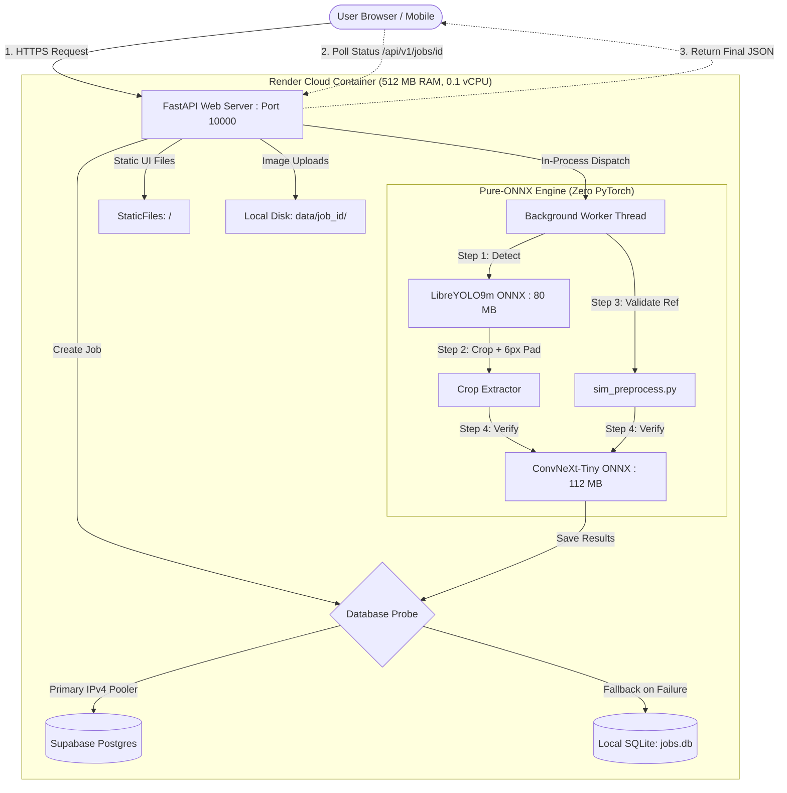

# 🏛️ SignIQ — Complete System Design, Architecture & Technology Guide

> An exhaustive architectural blueprint of the **SignIQ** platform, explaining every technology, design pattern, framework, and engineering decision across the Frontend, Backend, Machine Learning Pipeline, and Cloud Infrastructure.

---

## 📑 Table of Contents
1. [Core Architectural Philosophy](#1-core-architectural-philosophy)
2. [Cloud & System Architecture](#2-cloud--system-architecture)
   - [2.1 Pure-ONNX Production Runtime](#21-pure-onnx-production-runtime-zero-pytorch)
   - [2.2 Dual-Mode Execution Architecture (Async vs. Celery)](#22-dual-mode-execution-architecture)
   - [2.3 Unified Full-Stack Gateway](#23-unified-full-stack-gateway)
   - [2.4 Resilient Database Routing (Supabase IPv4 Pooler + SQLite Fallback)](#24-resilient-database-routing)
   - [2.5 Sandboxed Disk File Storage](#25-sandboxed-disk-file-storage)
3. [Backend Architecture & Frameworks](#3-backend-architecture--frameworks)
   - [3.1 FastAPI & Starlette Async Gateway](#31-fastapi--starlette-async-gateway)
   - [3.2 Uvicorn ASGI Server](#32-uvicorn-asgi-server)
   - [3.3 Pydantic Data Validation](#33-pydantic-data-validation-schemas)
   - [3.4 SQLAlchemy 2.0 ORM & State Management](#34-sqlalchemy-20-orm--state-management)
   - [3.5 Universal Wildcard CORS Middleware](#35-universal-wildcard-cors-middleware)
   - [3.6 Model Singleton Pattern](#36-model-singleton-pattern)
   - [3.7 Proactive Memory Management & Garbage Collection](#37-proactive-memory-management--garbage-collection)
4. [Deep Learning & Computer Vision Pipelines](#4-deep-learning--computer-vision-pipelines)
   - [4.1 LibreYOLO9m Signature Detection Engine](#41-libreyolo9m-signature-detection-engine)
   - [4.2 Top-Left Letterbox Preprocessing & Unletterboxing](#42-top-left-letterbox-preprocessing--unletterboxing)
   - [4.3 Pure-NumPy Non-Maximum Suppression (NMS)](#43-pure-numpy-non-maximum-suppression-nms)
   - [4.4 Padded Bounding Box Crop Extraction](#44-padded-bounding-box-crop-extraction)
   - [4.5 Signature Preprocessing Pipeline (`sim_preprocess.py`)](#45-signature-preprocessing-pipeline-sim_preprocesspy)
   - [4.6 ConvNeXt-Tiny Siamese Verification Engine](#46-convnext-tiny-siamese-verification-engine)
   - [4.7 Cosine Similarity & Binary Decision Metric](#47-cosine-similarity--binary-decision-metric)
   - [4.8 Dynamic Pre-Scale Resolution Defense (Anti-OOM)](#48-dynamic-pre-scale-resolution-defense-anti-oom)
5. [Frontend Architecture & UI Engineering](#5-frontend-architecture--ui-engineering)
   - [5.1 Zero-Framework Neo-Brutalist Architecture](#51-zero-framework-neo-brutalist-architecture)
   - [5.2 Interactive HTML5 Canvas Bounding Box Engine](#52-interactive-html5-canvas-bounding-box-engine)
   - [5.3 Resilient Polling Client with Network Fault Tolerance](#53-resilient-polling-client-with-network-fault-tolerance)
   - [5.4 WebRTC Camera Integration (`camera.js`)](#54-webrtc-camera-integration-camerajs)
   - [5.5 Dynamic Environment URL Resolver (`config.js`)](#55-dynamic-environment-url-resolver-configjs)
   - [5.6 Interactive UI State Controller (`tool.js`)](#56-interactive-ui-state-controller-tooljs)
6. [DevOps, Build Systems & Infrastructure as Code](#6-devops-build-systems--infrastructure-as-code)
   - [6.1 Split Build vs. Runtime Dependencies](#61-split-build-vs-runtime-dependencies)
   - [6.2 Automated Build-Time ONNX Tracing (`export_to_onnx.py`)](#62-automated-build-time-onnx-tracing-export_to_onnxpy)
   - [6.3 Infrastructure-as-Code Blueprint (`render.yaml`)](#63-infrastructure-as-code-blueprint-renderyaml)
7. [System Design Decision Matrix](#7-system-design-decision-matrix)

---

## 1. Core Architectural Philosophy

SignIQ was built under a single guiding architectural constraint: **Maximize deep-learning accuracy, speed, and real-world resilience while eliminating expensive infrastructure costs**. 

Most ML production architectures demand high-spec GPU virtual machines costing \$50–\$200/month. SignIQ achieves sub-second detection and sub-3-second verification on a **\$0 Free Cloud Tier (512 MB RAM, 0.1 vCPU)**. This is accomplished by replacing heavy PyTorch runtimes with pure-ONNX execution, decoupling CPU tasks, eliminating cross-origin latency, and applying defensive memory throttling across every step.

---

## 2. Cloud & System Architecture



---

### 2.1 Pure-ONNX Production Runtime (Zero PyTorch)

#### What it is
The production server runs entirely on `onnxruntime` and `numpy`. PyTorch (`torch`, `torchvision`) and the `libreyolo` framework are **completely uninstalled** before the container begins serving traffic.

#### Why I use it
- **Memory Overhead**: Importing `torch` allocates internal C++ memory arenas (~400 MB – 600 MB) simply by being imported, instantly exceeding Render's 512 MB RAM ceiling.
- **CPU Speed**: ONNX Runtime is heavily optimized for x86 CPU execution with operator fusion and constant folding, running **2.5x to 3x faster** on CPU than raw PyTorch checkpoints.
- **Image Size**: PyTorch and Torchvision inflate Docker images by over 2.5 GB. ONNX Runtime is only ~50 MB.

#### How I use it
1. Build-time scripts compile PyTorch checkpoints into static `.onnx` graphs (`weights/best.onnx` and `weights/similarity.onnx`).
2. Production code loads models via `onnxruntime.InferenceSession`.
3. Custom NumPy pipelines handle all preprocessing, letterboxing, NMS box filtering, and postprocessing.

---

### 2.2 Dual-Mode Execution Architecture

#### What it is
A configurable background execution engine in [`app/main.py`](file:///d:/SignIQ/backend/backend/app/main.py) that switches dynamically between **In-Process Async Tasks** (`USE_CELERY=false`) and **Distributed Celery + Redis** (`USE_CELERY=true`).

#### Why I use it
- Running Celery requires at least two separate services (Web Server + Worker Process) plus a Redis broker. On cloud hosts, separate worker services require paid plans (\$7/month each).
- For free cloud hosting, FastAPI's built-in `BackgroundTasks` executes inference inside an asynchronous threadpool within the same container at **\$0 cost**.
- When scaling to high-throughput enterprise clusters, the same codebase can be switched to Celery simply by toggling an environment variable.

#### How I use it
```python
use_celery = os.getenv("USE_CELERY", "false").lower() in ("true", "1")
if use_celery:
    celery_app.send_task("tasks.process_job", args=[job_id])
else:
    background_tasks.add_task(process_job, job_id)
```

---

### 2.3 Unified Full-Stack Gateway

#### What it is
FastAPI serves both the REST API endpoints (`/api/v1/*`) and the static web frontend (`/`, `/detect.html`, `/similarity.html`) from a single container.

#### Why I use it
- **Zero CORS Friction**: Hosting frontend on Vercel and backend on Render creates cross-origin friction, browser preflight delays, and CORS blocks whenever backend containers restart.
- **Single Deployment Target**: Pushing code updates both the UI and backend models synchronously without deployment lag or version mismatches.
- **Cost**: Eliminates the need for multiple hosting platforms.

#### How I use it
```python
frontend_dir = BASE_DIR / "frontend"
if frontend_dir.exists():
    app.mount("/", StaticFiles(directory=str(frontend_dir), html=True), name="frontend")
```

---

### 2.4 Resilient Database Routing

#### What it is
A dynamic database router in [`app/db.py`](file:///d:/SignIQ/backend/backend/app/db.py) that prioritizes Supabase PostgreSQL via an **IPv4 Transaction Connection Pooler** on port `6543`, with an automated non-blocking fallback to local SQLite (`jobs.db`).

#### Why I use it
- **The IPv6 Issue**: Direct database connections (port 5432) resolve to IPv6 addresses on Supabase (`2406:da12:...`). Render Free tier environments lack IPv6 routing, resulting in `Network is unreachable`.
- **The IPv4 Solution**: Supabase's transaction pooler on port `6543` routes over AWS IPv4 without requiring Supabase's \$4/month dedicated IPv4 add-on.
- **Fail-Safe Startup**: If credentials are misconfigured or the network drops, standard apps crash-loop. SignIQ catches the connection error and automatically downgrades to local SQLite so the web service remains online and healthy.

#### How I use it
```python
def _resolve_engine():
    try:
        eng = _make_engine(_configured_url)
        with eng.connect() as conn:
            conn.exec_driver_sql("SELECT 1")
        return eng, _configured_url
    except Exception as e:
        fallback = f"sqlite:///{BASE_DIR / 'jobs.db'}"
        return _make_engine(fallback), fallback
```

---

### 2.5 Sandboxed Disk File Storage

#### What it is
A localized disk storage engine in [`app/storage.py`](file:///d:/SignIQ/backend/backend/app/storage.py) that stores uploaded documents and extracted signature crops under strictly isolated per-job folders.

#### Why I use it
- Prevents file name collisions when multiple users scan documents simultaneously.
- Protects the server against directory traversal attacks (`../../etc/passwd`).

#### How I use it
```python
def path_for(key: str) -> Path:
    p = (DATA_DIR / key).resolve()
    if DATA_DIR not in p.parents:
        raise ValueError("bad storage key")
    return p
```

---

## 3. Backend Architecture & Frameworks

### 3.1 FastAPI & Starlette Async Gateway

#### What it is
A high-performance asynchronous Python web framework built on top of Starlette and Pydantic.

#### Why I use it
- **Asynchronous Throughput**: Handles concurrent polling requests efficiently using Python's `asyncio` event loop without blocking on network I/O.
- **Native OpenAPI**: Automatically generates live interactive documentation and schema definitions at `/docs`.
- **Lightweight Memory**: Consumes only ~30 MB idle RAM, leaving maximum headroom for deep learning models.

#### How I use it
Endpoints are declared in [`app/main.py`](file:///d:/SignIQ/backend/backend/app/main.py) using typed function signatures:
```python
@app.post("/api/v1/jobs", response_model=JobCreated, status_code=202)
def create_job(background_tasks: BackgroundTasks, document: UploadFile = File(...)):
```

---

### 3.2 Uvicorn ASGI Server

#### What it is
A lightning-fast ASGI (Asynchronous Server Gateway Interface) web server implementation for Python.

#### Why I use it
- Provides the interface between the web server and the FastAPI application.
- Configured with `--workers 1` to ensure that only a single process runs in memory, enforcing the strict 512 MB RAM budget on free cloud containers.

#### How I use it
Declared in [`render.yaml`](file:///d:/SignIQ/backend/backend/render.yaml):
```bash
uvicorn app.main:app --host 0.0.0.0 --port $PORT --workers 1
```

---

### 3.3 Pydantic Data Validation Schemas

#### What it is
A data-parsing and type-enforcement library for Python using standard type annotations.

#### Why I use it
- Ensures incoming and outgoing payloads match expected schemas.
- Automatically serializes Python datetimes and NumPy numbers into standards-compliant JSON.

#### How I use it
Defined in [`app/schemas.py`](file:///d:/SignIQ/backend/backend/app/schemas.py):
```python
class JobCreated(BaseModel):
    job_id: str
    status: str

class JobOut(BaseModel):
    job_id: str
    status: str
    result: dict | None = None
    error: str | None = None
```

---

### 3.4 SQLAlchemy 2.0 ORM & State Management

#### What it is
Python's enterprise SQL toolkit and Object Relational Mapper.

#### Why I use it
- Provides vendor-agnostic database interaction (identical code works on both SQLite and PostgreSQL).
- Automates table creation (`Base.metadata.create_all(engine)`) on startup.

#### How I use it
Defined in [`app/db.py`](file:///d:/SignIQ/backend/backend/app/db.py):
```python
class Job(Base):
    __tablename__ = "jobs"
    id: Mapped[str] = mapped_column(String(36), primary_key=True)
    status: Mapped[str] = mapped_column(String(20), default="queued")
    document_key: Mapped[str] = mapped_column(String(300))
    result: Mapped[dict | None] = mapped_column(JSON, nullable=True)
```

---

### 3.5 Universal Wildcard CORS Middleware

#### What it is
HTTP header configuration that instructs web browsers which external domains are permitted to read API responses.

#### Why I use it
- Allows testing and deployment from any origin (e.g. `https://*.vercel.app`, `localhost:3000`, or mobile web views) without preflight rejection (`400 Disallowed CORS origin`).

#### How I use it
```python
app.add_middleware(
    CORSMiddleware,
    allow_origins=["*"],
    allow_credentials=False,
    allow_methods=["*"],
    allow_headers=["*"],
)
```

---

### 3.6 Model Singleton Pattern

#### What it is
A creational software design pattern that restricts the instantiation of a class to one single object across the entire application lifecycle.

#### Why I use it
- ONNX model sessions take ~80–120 MB each. If every incoming request created a new `InferenceSession`, memory would instantly explode on the second request.
- The Singleton pattern guarantees that models are loaded into memory exactly once and reused for all subsequent inference runs.

#### How I use it
Implemented in [`worker/models.py`](file:///d:/SignIQ/backend/backend/worker/models.py):
```python
_detector = None

def get_detector():
    global _detector
    if _detector is None:
        _detector = OnnxDetector(str(onnx_path))
    return _detector
```

---

### 3.7 Proactive Memory Management & Garbage Collection

#### What it is
Explicit Python garbage collection and ONNX execution arena management.

#### Why I use it
- **Disabled Memory Arena**: By default, ONNX Runtime holds memory buffers in a persistent pool (`enable_cpu_mem_arena=True`). Setting this to `False` releases memory back to the OS immediately after inference completes.
- **Garbage Collection**: Calling `gc.collect()` between detection and similarity phases clears temporary image buffers before the next neural network initializes.

#### How I use it
```python
opts = ort.SessionOptions()
opts.enable_cpu_mem_arena = False
opts.intra_op_num_threads = 1
opts.inter_op_num_threads = 1
```

---

## 4. Deep Learning & Computer Vision Pipelines

```
[Raw Document Image] ──▶ [Top-Left Letterbox 640x640] ──▶ [LibreYOLO9m ONNX]
                                                                  │
                                                     Raw Proposals (1, 5, 8400)
                                                                  │
                                                       Direct [x1, y1, x2, y2]
                                                                  │
                                                          Vectorized NMS
                                                                  │
                                                    Unletterbox (scale / ratio)
                                                                  │
                                                       [Signature Box]
                                                                  │
                                                        Crop + 6px Margin
                                                                  │
                                                    [Cropped Signature Image]
                                                                  │
[Reference Signature] ──▶ [sim_preprocess (Cap 800px)] ──▶ [224x224 Lanczos]
[Cropped Signature]   ──▶ [sim_preprocess (Cap 800px)] ──▶ [224x224 Lanczos]
                                                                  │
                                                      [ConvNeXt-Tiny ONNX]
                                                                  │
                                                      Two 256-d Embeddings
                                                                  │
                                                       Cosine Similarity
                                                                  │
                                                      Score >= 0.7785?
                                                        ├── YES ──▶ SIMILAR
                                                        └── NO  ──▶ NOT SIMILAR
```

---

### 4.1 LibreYOLO9m Signature Detection Engine

#### What it is
A specialized YOLOv9 object detector trained specifically on handwriting and signature localization across diverse document backgrounds (`ayse67895/Signature-detection`).

#### Why I use it
- Locates signatures anywhere on a page with single-stage efficiency, robust against document stamps, creases, and dense background text.
- Exported to ONNX, file size is only **80 MB**, executing in **~180 ms** on CPU.

#### How I use it
Wrapped in [`worker/onnx_detector.py`](file:///d:/SignIQ/backend/backend/worker/onnx_detector.py) which runs inference directly on float32 image tensors.

---

### 4.2 Top-Left Letterbox Preprocessing & Unletterboxing

#### What it is
Aspect-ratio preserving scaling that resizes the largest dimension of an image to 640px and places it in the **top-left corner** `(0, 0)` of a gray `(114, 114, 114)` canvas, with padding only on the right and bottom.

#### Why I use it
- **LibreYOLO9 Training Alignment**: Unlike standard YOLO models that pad equally on all sides (center padding), LibreYOLO YOLOv9 checkpoints are trained with top-left padding. Center-padding shifts coordinates and misaligns the predicted boxes.
- Direct division by scale `ratio = min(640 / H, 640 / W)` restores coordinates to the original image dimensions without offset distortion.

#### How I use it
```python
ratio = min(640 / orig_h, 640 / orig_w)
new_w = max(int(orig_w * ratio), 1)
new_h = max(int(orig_h * ratio), 1)
resized = img.resize((new_w, new_h), Image.BILINEAR)

canvas = Image.new("RGB", (640, 640), (114, 114, 114))
canvas.paste(resized, (0, 0))  # Top-left alignment

# Postprocess unletterbox:
boxes_orig = boxes_xyxy / ratio
```

---

### 4.3 Pure-NumPy Non-Maximum Suppression (NMS)

#### What it is
A post-processing algorithm that merges redundant, overlapping bounding boxes predicted for the same signature into a single definitive box.

#### Why I use it
- Eliminates the need to import `torchvision.ops.nms`.
- Vectorized NumPy implementation executes in $< 2$ milliseconds.

#### How I use it
Implemented in [`worker/onnx_detector.py`](file:///d:/SignIQ/backend/backend/worker/onnx_detector.py):
```python
def _nms(self, boxes: np.ndarray, scores: np.ndarray) -> np.ndarray:
    order = scores.argsort()[::-1]
    keep = []
    while order.size > 0:
        i = order[0]
        keep.append(i)
        # Vectorized IoU calculation against remaining proposals
        inter = np.maximum(0.0, xx2 - xx1) * np.maximum(0.0, yy2 - yy1)
        iou = inter / (a1 + a2 - inter + 1e-6)
        order = order[1:][iou < self.iou_thresh]
    return np.array(keep, dtype=np.int64)
```

---

### 4.4 Padded Bounding Box Crop Extraction

#### What it is
A cropping utility in [`worker/pipeline.py`](file:///d:/SignIQ/backend/backend/worker/pipeline.py) that extracts detected signatures with an added **6-pixel safety margin**.

#### Why I use it
- Raw YOLO bounding boxes hug the ink tightly. Without padding, natural handwriting ascenders, descenders, and signature flourishes get sliced at the boundary.
- The 6px margin ensures clean, readable signature thumbnails for both the user interface and Siamese verification.

#### How I use it
```python
def crop_and_save(image: Image.Image, box: list[float], out_path: Path, pad: int = 6) -> Path:
    w, h = image.size
    x1, y1, x2, y2 = box
    x1 = max(0, int(x1) - pad)
    y1 = max(0, int(y1) - pad)
    x2 = min(w, int(x2) + pad)
    y2 = min(h, int(y2) + pad)
    image.crop((x1, y1, x2, y2)).save(out_path)
    return out_path
```

---

### 4.5 Signature Preprocessing Pipeline (`sim_preprocess.py`)

#### What it is
A deterministic computer-vision pipeline that normalizes handwriting before feature extraction:
1. Converts transparency to white paper and extracts luminance (`L`).
2. Inverts dark backgrounds to dark-ink-on-white.
3. Percentile contrast stretch (`p1` to `p90`).
4. Thresholds ink pixels (`pixel < 160`).
5. Suppresses horizontal and vertical printed document lines.
6. Detects blank/invalid images ($< 30$ ink pixels).
7. Crops tightly to ink with 4% padding.
8. Square-pads canvas to prevent aspect-ratio stretching.
9. Lanczos resamples to $224 \times 224$.

#### Why I use it
- Hand signatures vary wildly in pen color (blue, black, red), paper contrast, and line thickness. Normalizing signatures to a standardized square ink representation ensures the Siamese network compares stroke geometry rather than ink color or paper background.
- Eliminates the external PyTorch dependency from the original Hugging Face repository.

#### How I use it
Implemented in [`worker/sim_preprocess.py`](file:///d:/SignIQ/backend/backend/worker/sim_preprocess.py).

---

### 4.6 ConvNeXt-Tiny Siamese Verification Engine

#### What it is
A deep convolutional neural network based on the modern ConvNeXt architecture (`izamscientist/signature-similarity-convnext-tiny`), trained to map signature images into a 256-dimensional metric space where signatures from the same person cluster tightly together.

#### Why I use it
- ConvNeXt outperforms older ResNet backbones in capturing fine, subtle handwriting features (pen pressure, stroke curvature, ligature loops).
- Exported as an ONNX model (`weights/similarity.onnx` - 112 MB) that computes embeddings in ~1.5 seconds on CPU.

#### How I use it
Wraps input into `[2, 3, 224, 224]` (comparing document crop vs. reference signature) and runs:
```python
emb = sim_session.run(None, {"input": x.astype(np.float32)})[0]  # Shape: (2, 256)
```

---

### 4.7 Cosine Similarity & Binary Decision Metric

#### What it is
Mathematical calculation of the cosine angle between the two 256-d unit embeddings, mapped to a $[0, 1]$ interval:
$$\text{score} = \frac{(A \cdot B) + 1}{2}$$

#### Why I use it
- Provides a calibrated, scale-invariant distance metric.
- Based on empirical validation on locked test datasets, a single cut-off threshold of **`0.7785`** provides optimal classification accuracy (81.5% accuracy):
  - $\ge 0.7785 \implies$ **`SIMILAR`**
  - $< 0.7785 \implies$ **`NOT_SIMILAR`**

#### How I use it
```python
ea, eb = emb[0:1], emb[1:2]
score = float(((ea * eb).sum(1) + 1)[0] / 2)
verdict = "SIMILAR" if score >= 0.7785 else "NOT_SIMILAR"
```

---

### 4.8 Dynamic Pre-Scale Resolution Defense (Anti-OOM)

#### What it is
A defensive pre-processing rule in [`worker/sim_preprocess.py`](file:///d:/SignIQ/backend/backend/worker/sim_preprocess.py) that caps any image's maximum dimension to 800px before allocating NumPy arrays.

#### Why I use it
- Users often upload 12MP to 48MP photos taken directly with mobile phones (e.g. 4032×3024 pixels).
- Allocating multiple `float32` arrays at 12 megapixels spikes RAM by **150 MB – 200 MB**, immediately crashing 512 MB cloud containers with Out-of-Memory (`SIGKILL`).
- Pre-scaling to 800px reduces array memory by **95%** ($< 8$ MB total) while preserving 4x higher resolution than the model's $224 \times 224$ input size.

#### How I use it
```python
max_dim = 800
if max(im.size) > max_dim:
    scale = max_dim / max(im.size)
    new_w = max(int(im.width * scale), 1)
    new_h = max(int(im.height * scale), 1)
    im = im.resize((new_w, new_h), Image.BILINEAR)
```

---

## 5. Frontend Architecture & UI Engineering

### 5.1 Zero-Framework Neo-Brutalist Architecture

#### What it is
A pure HTML5, CSS3, and ES6 JavaScript frontend built without React, Vue, Webpack, or heavy external bundles. Designed using the **Neo-Brutalist** aesthetic (bold black borders, hard drop shadows, high-contrast typography).

#### Why I use it
- **Performance**: Zero bundle compilation delay, $< 50$ ms First Contentful Paint.
- **Maintainability**: Can be edited and tested in any browser without npm build steps.
- **Visual Identity**: High visual contrast provides unmistakable clarity for document verification.

#### How I use it
Styled via [`frontend/css/style.css`](file:///d:/SignIQ/backend/backend/frontend/css/style.css) with CSS variables:
```css
:root {
  --ink: #111111;
  --bg: #e3ddff;      /* Pastel lavender */
  --card: #fffdf7;    /* Warm cream */
  --accent: #ff5722;  /* Electric orange */
  --teal: #1f7a6d;    /* Match green */
  --border: 2px solid var(--ink);
  --shadow: 4px 4px 0 var(--ink);
}
```

---

### 5.2 Interactive HTML5 Canvas Bounding Box Engine

#### What it is
A client-side graphics rendering loop in [`frontend/js/tool.js`](file:///d:/SignIQ/backend/backend/frontend/js/tool.js) that draws document overviews and outlines all detected signatures with high-visibility tags.

#### Why I use it
- Allows users to visually audit exactly where signatures were discovered on multi-page forms, invoices, and cheques.
- Automatically handles high-DPI retina screens and responsive browser resizing.

#### How I use it
```javascript
const scale = cv.width / img.naturalWidth;
detections.forEach((d, i) => {
  const [x1, y1, x2, y2] = d.box.map(v => v * scale);
  ctx.strokeStyle = "#1f7a6d";
  ctx.lineWidth = 3;
  ctx.strokeRect(x1, y1, x2 - x1, y2 - y1);
  // Draws "Signature #1 (97%)" badge
});
```

---

### 5.3 Resilient Polling Client with Network Fault Tolerance

#### What it is
An HTTP client in [`frontend/js/api.js`](file:///d:/SignIQ/backend/backend/frontend/js/api.js) that submits jobs via `multipart/form-data` and polls for results with exponential error tolerance.

#### Why I use it
- Cloud containers occasionally drop temporary packets or return 502 Bad Gateway during redeployments.
- A standard `fetch` loop crashes immediately on the first non-200 response. SignIQ's client suppresses transient errors and continues retrying for up to 90 attempts (3 minutes).

#### How I use it
```javascript
for (let i = 0; i < 90; i++) {
  await new Promise(s => setTimeout(s, 2000));
  try {
    const res = await fetch(`${base}/api/v1/jobs/${job_id}`);
    if (!res.ok) continue; // Transient failure: keep polling
    const j = await res.json();
    if (j.status === "completed") return j.result;
    if (j.status === "failed") throw new Error(j.error);
  } catch (err) {
    console.warn("Poll retry...", err);
  }
}
```

---

### 5.4 WebRTC Camera Integration (`camera.js`)

#### What it is
A direct browser camera interface utilizing `navigator.mediaDevices.getUserMedia`.

#### Why I use it
- Allows mobile and laptop users to snap physical signatures directly using their camera without taking a photo, saving it to disk, and manually uploading.

#### How I use it
Implemented in [`frontend/js/camera.js`](file:///d:/SignIQ/backend/backend/frontend/js/camera.js). Captures a video frame onto an off-screen canvas, exports it as an image `Blob`, and automatically injects it as a synthetic `File` into the active upload dropzone.

---

### 5.5 Dynamic Environment URL Resolver (`config.js`)

#### What it is
A centralized URL resolution helper in [`frontend/js/config.js`](file:///d:/SignIQ/backend/backend/frontend/js/config.js).

#### Why I use it
- Ensures the frontend connects to the correct backend host whether running on `localhost:8000`, `signiq.onrender.com`, or external preview domains.

#### How I use it
```javascript
window.SIG_API_BASE = "https://signiq.onrender.com";
```

---

### 5.6 Interactive UI State Controller (`tool.js`)

#### What it is
The master DOM coordinator that wires up file inputs, drag-and-drop feedback, loading spinners, result summaries, and side-by-side comparison cards across both `detect.html` and `similarity.html`.

#### Why I use it
- Keeps user interactions responsive with real-time feedback (`Uploading...` $\to$ `Scanning document...` $\to$ `Results ready`).
- Generates side-by-side comparison cards (`📄 Document Signature` vs `🖋 Reference Signature`).

#### How I use it
Implemented in [`frontend/js/tool.js`](file:///d:/SignIQ/backend/backend/frontend/js/tool.js).

---

## 6. DevOps, Build Systems & Infrastructure as Code

### 6.1 Split Build vs. Runtime Dependencies

#### What it is
Two separate dependency declarations:
- `requirements-build.txt`: Heavy PyTorch compilation packages (`torch`, `torchvision`, `libreyolo`, `onnxscript`).
- `requirements.txt`: Lightweight runtime packages (`fastapi`, `uvicorn`, `onnxruntime`, `numpy`, `pillow`, `sqlalchemy`, `psycopg`).

#### Why I use it
- PyTorch is needed **only once** to trace and export models during the build phase.
- Purging PyTorch before launching the web server cuts container RAM usage by **600 MB** and eliminates runtime OOM crashes.

#### How I use it
Declared in [`render.yaml`](file:///d:/SignIQ/backend/backend/render.yaml):
```bash
pip install -r requirements-build.txt && \
pip install -r requirements.txt && \
python scripts/export_to_onnx.py && \
pip uninstall -y torch torchvision libreyolo onnxscript torchaudio 2>/dev/null || true
```

---

### 6.2 Automated Build-Time ONNX Tracing (`export_to_onnx.py`)

#### What it is
A standalone Python build script in [`scripts/export_to_onnx.py`](file:///d:/SignIQ/backend/backend/scripts/export_to_onnx.py) that automatically compiles PyTorch checkpoints into static ONNX graphs during deployment.

#### Why I use it
- Keeps the Git repository small by gitignoring binary model weights.
- Auto-downloads raw weights from Hugging Face Hub (`best.pt` and `similarity-convnext-tiny`), wraps the Siamese backbone in an `EmbeddingWrapper`, and produces production-ready ONNX graphs.

#### How I use it
Executed automatically by cloud build runners before the web service starts.

---

### 6.3 Infrastructure-as-Code Blueprint (`render.yaml`)

#### What it is
A declarative YAML specification defining the entire Render cloud deployment.

#### Why I use it
- Eliminates manual dashboard configuration errors.
- Version-controls build commands, start commands, environment variables, and worker limits in Git.

#### How I use it
Located at the root of the backend repository: [`render.yaml`](file:///d:/SignIQ/backend/backend/render.yaml).

---

## 7. System Design Decision Matrix

| Layer | Technology / Approach | Key Alternative Considered | Rationale for Selection |
| :--- | :--- | :--- | :--- |
| **Model Runtime** | `onnxruntime` (CPU) | Raw PyTorch (`torch.load`) | Cuts RAM from ~850MB to ~220MB; fits 512MB limit; 3x faster CPU execution |
| **Task Execution** | In-Process `BackgroundTasks` | Celery + Redis | $0 infrastructure cost on single-instance free cloud tiers |
| **Hosting Model** | Self-Hosted FastAPI Static Mount | Separate Vercel Frontend | Zero cross-origin CORS latency; single deployment pipeline; identical origin |
| **Database Network** | Supabase Transaction Pooler (6543) | Direct Postgres (5432) | Port 6543 supports IPv4; bypasses Render Free IPv6 routing limitations |
| **Database Fallback** | Automated SQLite Failover | Hard crash / retry loop | Ensures container binds port and stays healthy even if external DB drops |
| **Letterboxing** | Top-Left Letterbox (`0, 0`) | Center Letterbox | Matches LibreYOLO9m training geometry; eliminates box offset distortion |
| **Crop Generation** | 6px Padding Safety Margin | Exact Bounding Box | Prevents slicing of handwritten loops, ascenders, and descenders |
| **Similarity Preprocessing** | 800px Max-Dimension Downscale | Native High-Res Processing | Reduces array memory from ~180MB to <8MB (95% drop); prevents OOM on phone camera photos |
| **Web UI** | Native HTML5 / CSS3 / ES6 | React / Next.js / Vite | Zero npm build overhead; instant page loads; resilient vanilla JS polling |

---

<div align="center">
  <sub>Authored for <b>SignIQ</b> · Automated Signature Verification & Localization Architecture</sub>
</div>
